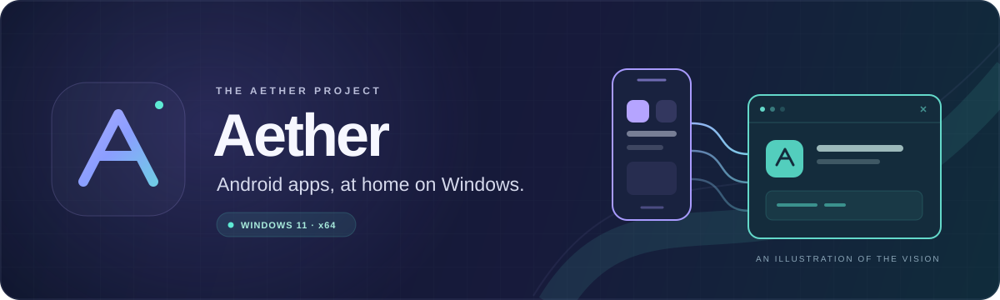
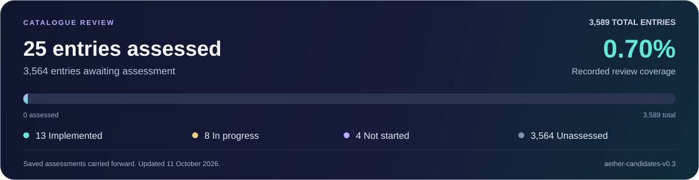

  

# Aether

**Bringing Android apps to your Windows desktop.**

Aether is a project working towards a simple idea: install an Android app on your PC, open it in a normal Windows window, and manage it through Windows.

This page explains the project in everyday language. No programming knowledge needed.

**Project snapshot · 11 October 2026 · Windows 11 on Intel or AMD PCs (64-bit)**

[The idea](#the-idea) · [Where we are](#where-we-are) · [What works](#what-works-today) · [Roadmap](#roadmap) · [Progress counts](#progress-counts) · [Trying Aether](#can-i-try-it)

> **Currently in development.** Eight development phases are complete. Phase 8, Windows integration and wider app support, is in progress. Aether can run its own test apps, but everyday Android app compatibility is still limited.

## The idea

Android apps expect features that Windows does not provide in the same way. Aether acts as a translator: it runs supported Android app code and connects supported app features to Windows.

Windows does the underlying work, without needing to start an Android operating system or a virtual machine. Aether also translates supported ARM64 code, commonly used by Android phones, for Intel and AMD PCs.

### The experience we are building

1. **Install Aether once.** One shared installation supports your compatible Android apps.
2. **Open an Android app file.** An **APK** is an Android installation file. Open it through File Explorer, review the app details and permissions, then approve installation.
3. **Launch it like a Windows app.** Find it in Start or Search and use it in its own window, with its own name, icon and private app data.
4. **Manage it through Windows.** Update compatible apps while keeping their data, and remove individual apps through Windows Settings.

You can choose Aether to open APK files when you double-click them. Opening an APK brings up installation review; it does not silently run the app.

**This is the intended finished experience.** Much of the underlying installation and launch system exists, while checks of the actual Windows menus, taskbar and Settings screens are still unfinished. The plan uses Windows' familiar controls, with small Aether dialogs when needed.

## Where we are

| At a glance | Current position |
| :--- | :--- |
| **Development phases** | **8 complete · 1 in progress**, numbered 0–8 |
| **Current focus** | **Phase 8:** Windows installation, launch, updates and wider compatibility |
| **Distinct working test apps** | **2**, towards the Phase 8 minimum of **3** |
| **Compatibility checklist** | **3,589 planning entries** across **43 areas** |
| **Catalogue review** | **25 of 3,589 assessed (0.70%)** · **3,564 still unassessed** |
| **Public release** | Still in development; release requirements remain open |

Development phases vary greatly in size. Completing eight phases does not mean the finished product is almost ready, or that a similar share of Android apps will work.

The [project progress record](docs/PROGRESS.md) and [app compatibility record](docs/COMPATIBILITY_MATRIX.md) contain the evidence behind this snapshot.

## What works today

| Area | What Aether can currently do |
| :--- | :--- |
| **Read app files** | Inspect supported APKs and show details such as the app name, version and requested permissions. Report unsupported formats. |
| **Run our test apps** | Open supported app screens in resizable Windows windows and handle mouse and keyboard input. |
| **Install and remove apps** | Keep installed packages and app data separately, create Start shortcuts and Windows uninstall entries, and ask for installation and permission choices. |
| **Limit app access** | Run installed app code with Windows restrictions, check that installed files have not changed before launch, and control access to supported services. |
| **Check and update apps** | Verify supported app signatures and update eligible apps while keeping their identity, data and permissions. Handle tested interrupted updates. |
| **Reopen the right app** | Keep an app-specific launch command working after a supported app update. Actual pinned-taskbar behaviour still needs checking. |
| **Update Aether itself** | Update the shared Aether software at the same location while preserving installed apps and their Windows entries, when the versions are compatible. |
| **Graphics and sound foundations** | Separate test programs demonstrate graphics through Windows' graphics hardware and audio through Windows' sound system. General Android graphics and media support is unfinished. |

These features have specific limits. A successful installation or signature check does not establish that an app will run correctly. The graphics and audio demonstrations are separate from the test apps' ordinary screens.

### Recent additions

- **App updates with identity checks:** supported updates must retain the installed app's verified signing identity. Data and permission choices are preserved. [Details](docs/adr/0039-verified-apk-updates.md)
- **More reliable app relaunch:** Windows launch information points back to the right installed app, including after an update. [Details](docs/adr/0040-installed-window-relaunch.md)
- **Compatible Aether upgrades:** the shared software can be updated at its existing location, with an explicit recovery process for supported interrupted upgrades. [Details](docs/adr/0041-compatible-runtime-upgrades.md)
- **Expanded compatibility planning:** all 2,435 v0.2 additions and 134 researched requirements are now in the 3,589-entry main catalogue, with source links and future goals. [Explore the checklist](docs/compatibility/FUTURE_GOALS.md)

## Roadmap

The plan starts at **Phase 0**, so there are **nine phases** in total. “Complete” means the phase's recorded milestone has been accepted within its documented scope; support continues to grow afterwards.

| Phase | In everyday language | Status |
| :---: | :--- | :--- |
| **0** | Set up the project, build tools and tests | ✅ Complete |
| **1** | Read and inspect Android installation files | ✅ Complete |
| **2** | Translate supported instructions used by phone processors for a PC | ✅ Complete |
| **3** | Load and run the extra code packaged inside supported apps | ✅ Complete |
| **4** | Run Android app logic and connect its different code parts | ✅ Complete |
| **5** | Support basic screens and opening, using and closing an app | ✅ Complete |
| **6** | Connect windows, input, graphics and audio to Windows | ✅ Complete |
| **7** | Establish app isolation and security controls | ✅ Complete |
| **8** | Make installation, updates and everyday Windows use work with more apps | 🔨 In progress |

Phase 7 is complete under the recorded owner acceptance. Its evidence and verification exceptions remain documented in the [security record](docs/PHASE7_SECURITY_EVIDENCE.md).

### What comes next

- **Finish the Windows experience.** Check real File Explorer, Open With, Start, Search, Settings and taskbar pinning, including app icons after updates.
- **Validate installation on a fresh PC.** Complete installer and recovery checks beyond the current development machine.
- **Run more distinct apps.** Reach at least three compatible apps and expand the Android features they need. Repackaging an existing test app does not count as another app.
- **Broaden updates and compatibility.** Add more supported package and signature formats, and handle upgrades that require changes to stored data or runtime formats.
- **Improve user controls and troubleshooting.** Finish the needed per-app settings and diagnostics, alongside usability and performance work.
- **Prepare for release.** Resolve distribution signing, privacy, licensing and the remaining release checks.

Alongside this work, the [future compatibility goals](docs/compatibility/FUTURE_GOALS.md) now include every owner v0.2 list plus additional researched requirements. This update prepares the lists; it does not inspect code or test whether features work.

The [engineering roadmap](docs/ROADMAP.md) and [master plan](AETHER_MASTER_PLAN_v1.1.md) hold the full requirements. The full project remains unfinished.

## Progress counts

The compatibility checklist is a list of **future Android and Windows requirements**. It now contains **3,589 planning entries**, including broad requirements and their more detailed refinements.

  

The bar shows **recorded catalogue review coverage**: **25 of 3,589 entries (0.70%)** have a prior assessment, and **3,564 remain Unassessed**. The assessed entries comprise 13 recorded as Implemented, 8 In progress and 4 Not started. Their implementation and test evidence has not been rechecked.

| Inventory source | Entries |
| :--- | ---: |
| Original catalogue, preserved | 1,020 |
| Owner's v0.2 additions, integrated | 2,435 |
| Further researched requirements | 134 |
| **Total planning entries** | **3,589** |

The new requirements cover areas such as accessibility, text input, credentials/autofill, background work, Binder communication, WebView, native graphics buffers and newer Android behavior rules. [Read the future goals and sources](docs/compatibility/FUTURE_GOALS.md).

All new entries are **Unassessed**. Existing recorded statuses and evidence are retained without rechecking them. **No builds, tests or implementation checks were run for this list update.** A planning entry does not mean a feature is missing or working. Review coverage describes catalogue records. Overlapping requirements mean it cannot be used as a feature-completion percentage or an Android app success rate.

Browse the [detailed inventory counts](docs/compatibility/PROGRESS.md), [main CSV](docs/compatibility/capabilities.csv) or [Excel checklist](docs/compatibility/capabilities.xlsx). The [earlier audit report](docs/compatibility/AUDIT_REPORT_2026-10-11.md) remains a historical record.

## Which apps have been tried?

| App | What the record shows |
| :--- | :--- |
| **HelloAether** — our own test app | Opens a Windows window. Its button runs Android app code and translated ARM64 code, then displays **ARM64 result: 42**. |
| **PlainAether** — our second test app | Runs a separate, simpler Android app through the installed-app system. Its versions are also used to check updates and preserved app data. |
| **TikTok** — an owner-supplied APK | Inspection reaches unsupported package details. It has **not been executed or shown to work**. |

That is **two distinct working test apps**. Signed versions and modified copies of those apps do not increase the count. No downloaded third-party app is currently claimed compatible.

Installation of other APKs is enabled experimentally, with app isolation and explicit consent. Many will be refused or encounter missing features. The current execution path supports a limited standalone APK format with one app-code file and one main screen; many larger apps need more.

Support for Google Play Services, protected streaming, banking apps, games with anti-cheat, and universal Android compatibility is not promised. The [app compatibility record](docs/COMPATIBILITY_MATRIX.md) and [known limitations](docs/KNOWN_LIMITATIONS.md) give the exact boundaries.

## Can I try it?

**Aether is currently a development project.** A Windows installer is built by the project, but it is an unsigned development build and the complete public-release experience is still unfinished.

The current target is **Windows 11 on a 64-bit Intel or AMD PC**. Windows on ARM, macOS and Linux are outside the current target.

If you just want to follow the project, start with the roadmap and counts above. If you want to build and test it, the [Windows build guide](docs/BUILD_WINDOWS.md) lists the tools and commands, and the [Windows installation guide](docs/WINDOWS_NATIVE_INTEGRATION.md) explains installation and app management. Building currently requires developer tools.

### A few useful words

| Word | Plain-English meaning |
| :--- | :--- |
| **APK** | A file used to distribute and install an Android app. |
| **Runtime** | The shared Aether software that runs compatible apps. |
| **Compatibility** | How well an app's required features behave through Aether. |
| **App signature** | A digital seal used to check that an app file has not changed. It does not prove an app is safe. |
| **Sandbox / isolation** | Restrictions on an app's access to the PC and other apps' data. |
| **Test app / fixture** | A small app made specifically to check whether something works. |

## Explore further

| If you want to… | Read this |
| :--- | :--- |
| Follow recent work | [Progress and session reports](docs/PROGRESS.md) |
| See the detailed plan | [Roadmap](docs/ROADMAP.md) |
| Explore feature counts | [Compatibility catalogue](docs/compatibility/README.md) |
| See which apps work | [App compatibility](docs/COMPATIBILITY_MATRIX.md) |
| Understand current gaps | [Known limitations](docs/KNOWN_LIMITATIONS.md) |
| Build or install Aether | [Build guide](docs/BUILD_WINDOWS.md) · [Windows integration](docs/WINDOWS_NATIVE_INTEGRATION.md) |
| Understand the design | [Architecture](docs/ARCHITECTURE.md) · [Security model](docs/SECURITY_MODEL.md) |

## Credits and licensing

**Created by GPT6-ASTRA MAX.**

Aether uses third-party libraries, including Dynarmic for ARM64 translation and ANGLE for graphics. Their authors, licences and source records are acknowledged in the [third-party documentation](third_party/README.md).

**A distribution licence for Aether-owned code has not yet been chosen.** This repository does not grant an open-source or commercial licence for that code. See the [licensing decision](docs/LICENSING_DECISION.md).
