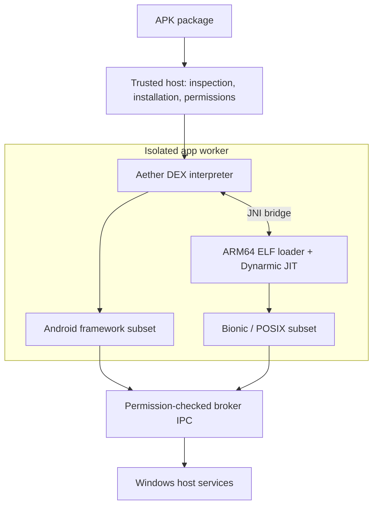

# Aether

**Android compatibility for Windows, built on native Windows processes.**

Aether is an experimental C++20 compatibility platform for **Windows 11 x64**. It combines an Android DEX interpreter, ARM64-to-x86-64 dynamic translation, and Windows-backed implementations of Android interfaces. Applications execute in Windows processes without booting an Android operating system or requiring WSA, WSL, a virtual machine, or an Android emulator.

The goal is a shared runtime that lets you install Android apps through File Explorer, launch them from Windows Start/Search, and remove them through Windows Installed apps. Each app gets its own identity, window, and private storage.

> **Development status:** Phase 8, native Windows integration, is in progress. Execution and installation are restricted to exact, self-authored development fixtures. General third-party APK support is disabled.

[Quick start](#quick-start) | [Current capabilities](#current-capabilities) | [Roadmap](#roadmap) | [Documentation](#documentation) | [Licensing](#licensing)

## Current capabilities

| Area | Implemented scope |
| --- | --- |
| APK inspection | Bounded ZIP, manifest, resource, DEX, and ELF inspection; package metadata, permissions, checksums, labels, and supported PNG icons. |
| Managed and native execution | An original DEX interpreter and JNI bridge, an Android ARM64 ELF loader, and Dynarmic translation into x86-64 machine code. |
| Activity and input | The included HelloAether Activity runs in a resizable Win32/GDI window. Mouse and keyboard input reaches its DEX/JNI/ARM64 code. |
| Graphics | A separate native fixture renders verified EGL/OpenGL ES pixels through an isolated ANGLE service backed by hardware Direct3D 11. |
| Audio | A separate native AAudio fixture sends verified PCM through broker-owned WASAPI playback in a private, muted test session. |
| Isolation | Less Privileged AppContainer (LPAC) workers, resource limits, permission-checked broker calls, protected per-app storage, and durable audit records. |
| Windows integration | Durable fixture installation, installed-ID launch, explicit permissions, Start shortcuts, per-app uninstall entries, labels/icons, and native uninstall confirmation. |

These are deliberately bounded implementations. The Activity uses GDI; the native graphics and audio demonstrations are separate fixtures. They do not establish general Android graphics, media, or application compatibility. See the [compatibility matrix](docs/COMPATIBILITY_MATRIX.md), [API support matrix](docs/API_SUPPORT_MATRIX.md), and [ABI support matrix](docs/ABI_SUPPORT_MATRIX.md) for the tested scope.

## Quick start

### Requirements

- **Windows 11 x64** on an Intel or AMD processor.
- **Visual Studio 2022 Build Tools** with the Desktop development with C++ workload, MSVC x64, Windows SDK, and C++ CMake tools/Ninja.
- **CMake 3.25 or newer** and **Python 3.10 or newer**.
- Git for working with the repository.

Dependencies and compiled first-party fixtures are retained in the repository. Configure/build does not download dependencies. Android SDK, NDK, and Java tools are needed only to rebuild Android fixtures; they are not runtime requirements.

### Build

Run from the repository root in PowerShell:

```powershell
./tools/build.ps1 -Preset windows-debug
./out/build/windows-debug/aether.exe --help
./out/build/windows-debug/aether.exe doctor --verbose
```

The build wrapper discovers the installed Visual Studio toolchain. Build outputs go to `out/build/windows-debug/`. Use `windows-release` for a Release build. See the [Windows build guide](docs/BUILD_WINDOWS.md) for toolchain details and fixture development.

### Run HelloAether

Inspect the included APK, then open its Activity:

```powershell
./out/build/windows-debug/aether.exe inspect ./tests/fixtures/hello-aether.apk --json
./out/build/windows-debug/aether.exe run ./tests/fixtures/hello-aether.apk
```

Click **Translate ARM64** in the window. The button executes DEX, crosses JNI into the translated ARM64 library, and displays **ARM64 result: 42**. The Activity executes in the isolated worker while the trusted Windows host presents its window.

For the Activity/lifecycle proof without opening a window:

```powershell
./out/build/windows-debug/aether.exe framework-selftest --apk ./tests/fixtures/hello-aether.apk --verbose
```

The fixture is built from [included source](tests/fixtures/README.md) and admitted by its exact checksum. Repacked, modified, or unrelated APKs are not admitted for execution.

### Preview fixture installation

```powershell
./out/build/windows-debug/aether.exe install ./tests/fixtures/hello-aether.apk --dry-run --json
```

This reports metadata, presentation, installation eligibility, and unverified signing without creating a package store or executing the app. The [Windows integration guide](docs/WINDOWS_NATIVE_INTEGRATION.md) covers confirmed installation, permission decisions, registration, installed-ID launch, and removal.

## Build and test

Both Debug and Release use CMake, Ninja, and CTest through the PowerShell wrappers. Run the presets sequentially because integration tests share Windows shell surfaces.

The current Phase 8 regression selection preserves the owner's stopped Phase 7 parser campaign:

```powershell
$phase8Exclusions = '^aether\.security\.(parser_(apk|dex|elf|supervision)|package_admission)$'

./tools/build.ps1 -Preset windows-debug
./tools/test.ps1 -Preset windows-debug -ExcludeRegex $phase8Exclusions -ReportName phase8-test-results.xml

./tools/build.ps1 -Preset windows-release
./tools/test.ps1 -Preset windows-release -ExcludeRegex $phase8Exclusions -ReportName phase8-test-results.xml
```

These commands select regression tests; they are not full-suite runs. They exclude five owner-stopped tests and keep the historical full-suite report separate. See the [test-selection contract](docs/BUILD_WINDOWS.md#build-and-test-from-ordinary-powershell).

Integration tests exercise real Windows processes, windows, storage, graphics, and audio. Relevant device tests require a hardware D3D11 adapter, a usable playback endpoint, and the documented physical webcam/integrated-microphone controls. Missing device prerequisites fail their checks. Current command results and environment limits are recorded in [progress and evidence](docs/PROGRESS.md).

## How it works

Aether implements three connected layers: managed DEX execution, native ARM64 translation, and Android API behavior backed by Windows.



The host owns window presentation, policy, and app storage. Guest execution receives bounded services through the broker. The native graphics path uses a separate isolated ANGLE renderer; the native audio path uses broker-owned WASAPI. Public contracts live under `include/aether/`, with implementations split into explicit modules.

See the [architecture](docs/ARCHITECTURE.md), [security model](docs/SECURITY_MODEL.md), and [architecture decisions](docs/adr/) for the detailed boundaries.

## Roadmap

**Phase 7 is complete by owner acceptance, recorded on 2026-10-10.** Its protections and retained evidence remain in place. That acceptance does not enable outside APK execution; the [security evidence ledger](docs/PHASE7_SECURITY_EVIDENCE.md) records the scope.

**Phase 8 is in progress.** The package store, installed-app launch, Windows registration, and bounded artwork are implemented for HelloAether. Remaining work includes:

- Native install confirmation with permission choices, and optional Explorer APK integration that respects Windows file-association choices.
- Actual Start/Search, Settings, and pinned-taskbar acceptance, plus broader icon/resource support.
- Verified APK signing and updates, shared-runtime installer/removal behavior, and safe dependency handling.
- At least three distinct compatible APKs and further Android framework, native ABI, graphics, and media coverage.

The intended product uses one shared runtime and Windows' existing app surfaces. No standalone app manager is planned. The full project is not complete; the [ordered roadmap](docs/ROADMAP.md) and [master engineering plan](AETHER_MASTER_PLAN_v1.1.md) define the remaining gates.

## Compatibility limits

- Execution currently targets the tested **arm64-v8a** subset. Other Android ABIs and universal instruction/API compatibility are outside the implemented scope.
- Broad Android framework services, Java Surface/media integration, concurrent guest threads, native TLS, and several ELF/Bionic features remain unfinished.
- APK signature verification, general installation admission, split-package installation, and verified update continuity remain unfinished.
- Google Play Services, Play Integrity, DRM, banking apps, and anti-cheat compatibility are not promised. No proprietary Google components or third-party APKs are bundled.

Unsupported behavior should produce an explicit diagnostic. The [known limitations](docs/KNOWN_LIMITATIONS.md) and support matrices describe the exact boundaries.

## Repository layout

| Path | Purpose |
| --- | --- |
| `apps/` | CLI, shared shell launcher, isolated workers, and runtime setup entry points. |
| `include/aether/` | Public module contracts. |
| `src/` | Runtime, translation adapters, Android compatibility, security, and Windows backends. |
| `tests/` | Unit, integration, security, and original fixture sources/data. |
| `tools/` | Build, test, installation, fixture, and dependency verification tools. |
| `cmake/` | Build configuration and dependency adapters. |
| `docs/` | Architecture, decisions, support matrices, evidence, and roadmap. |
| `third_party/` | Pinned dependencies, provenance, integration records, and license notices. |
| `out/` | Local build and test outputs; excluded from Git. |

## Documentation

- [Build on Windows](docs/BUILD_WINDOWS.md) and [Windows application integration](docs/WINDOWS_NATIVE_INTEGRATION.md).
- [DEX/JNI runtime](docs/DEX_JNI_RUNTIME.md), [ARM64 translation](docs/A64_TRANSLATION.md), and [ELF/native ABI](docs/ELF_NATIVE_ABI.md).
- [Android framework](docs/ANDROID_FRAMEWORK.md), [window/input](docs/WINDOW_HOST.md), [graphics](docs/GUEST_GRAPHICS.md), and [audio](docs/GUEST_AUDIO.md).
- [Isolated workers](docs/ISOLATED_WORKER.md), [security evidence](docs/PHASE7_SECURITY_EVIDENCE.md), and [current progress](docs/PROGRESS.md).

## Development

Use C++20, preserve module boundaries, and keep Windows x64 as the primary target. Compatibility changes need reproducible first-party fixtures, precise unsupported diagnostics, and current Debug/Release evidence. Follow [AGENTS.md](AGENTS.md), the [master plan](AETHER_MASTER_PLAN_v1.1.md), and the relevant [architecture decisions](docs/adr/) before making changes.

Record dependency provenance and license obligations before importing code. Document observed behavior and known gaps alongside implementation changes.

## Licensing

**A distribution license for Aether-owned code has not yet been selected.** This repository does not grant an open-source or commercial license for that code. See the [owner licensing decision](docs/LICENSING_DECISION.md).

Third-party components retain their own copyrights and licenses. Dynarmic provides ARM64 translation, ANGLE provides the graphics backend, miniz supplies archive/compression support, and doctest supports testing. Exact revisions, local patches, dependency notices, and fixture/toolchain attribution are recorded in [third-party provenance](third_party/README.md).
